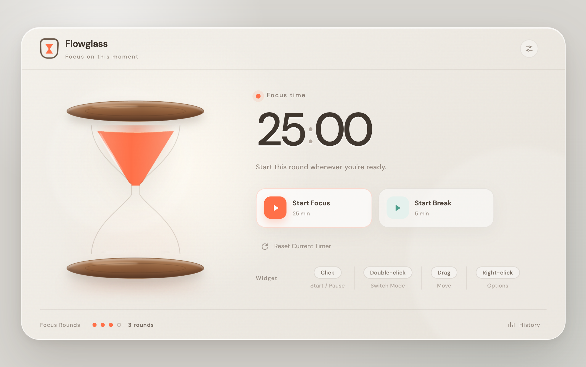
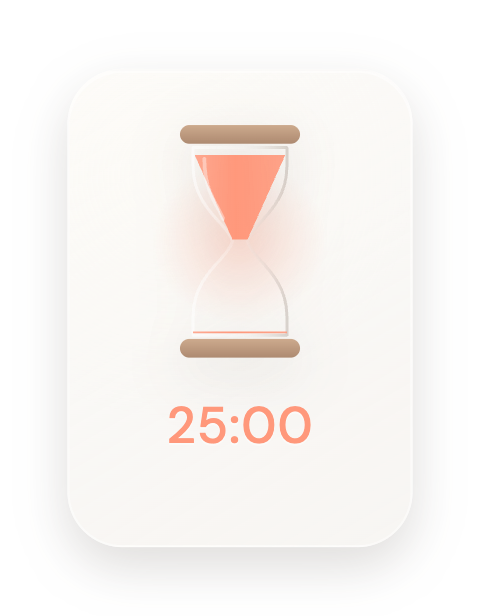

# Flowglass

A desktop Pomodoro timer with a little hourglass to keep you company.

Start a focus session, take a break, and keep the time in sight with Mini, a floating hourglass that stays above your other windows. Flowglass pairs warm, quiet visuals with a simple timer and a seven-day focus history.

[Download 0.2.1](https://github.com/Sal-Cmbfmj/flowglass-app/releases/tag/v0.2.1) · [Installation](docs/INSTALL.md) · [Known issues](docs/KNOWN-ISSUES.md) · [中文说明](#中文说明)

*Version 0.2.1 preview. The history shown in this image is example data.*

## Get started

Choose a package from the [0.2.1 release](https://github.com/Sal-Cmbfmj/flowglass-app/releases/tag/v0.2.1). You do not need the “Source code” downloads to use the app.

| Your computer | Choose the file ending in |
| --- | --- |
| Mac with Apple silicon — M1, M2 and later | `mac-arm64_20261019.zip` |
| Mac with an Intel processor | `mac-x64_20261019.zip` or `.dmg` |
| Windows PC with an x64 processor | `win-x64_20261019.exe` — experimental build |

These are early, unsigned test packages. macOS may show a developer-verification warning; Windows may show a SmartScreen prompt. Read the [installation guide](docs/INSTALL.md) before opening the app. Compatibility testing is still limited, particularly on Intel Macs and Windows PCs.

## A small tool for your focus sessions

- **Focus and break modes.** Set focus sessions from 1–120 minutes and breaks from 1–60 minutes. A session already started keeps its original length.
- **A floating Mini.** Keep a small hourglass on the desktop while the main window is tucked away.
- **A seven-day history.** See focus rounds and time recorded each day. Ending a focus session early still counts as a round if time was spent; paused time is excluded.
- **English and 简体中文.** Choose a language in Settings and save to apply it to both windows, including the Windows tray menu (since 0.2.2).
- **Local records.** No account or cloud sync is needed.

### Using Mini

| Gesture | Action |
| --- | --- |
| Click | Start, pause or resume |
| Double-click | Switch between focus and break, ready to start |
| Drag | Move Mini |
| Right-click | Open the timer menu |

A click waits briefly so the app can distinguish it from a double-click. A completed round stays finished until you start another one; there is no automatic focus/break cycle or sound alert.

Closing the main window hides it. On macOS, click the Dock icon to reopen it and use **⌘Q** to quit. On Windows, use the tray icon to reopen it and the tray menu to quit or show Mini.

## What to expect from this beta

0.2.1 adds more room for the interface, clearer Mini visibility, and Windows Mini recovery controls. It follows the English/Chinese interface introduced in 0.2.0.

There are a few known rough edges, including a language-draft issue when reopening Settings with a keyboard shortcut and a Settings panel that needs scrolling. See [known issues and workarounds](docs/KNOWN-ISSUES.md) before testing. The Windows package is cross-compiled from macOS; a full device and display-scaling compatibility matrix is not available yet.

## Your data

Settings, timer state and up to 5,000 session records are stored locally. Flowglass has no account system, analytics or timer-record uploads. It loads fonts from Google Fonts, which may make network requests; the Windows installer may also download WebView2 when it is missing.

The timer uses elapsed wall-clock time: sleep or quitting the app does not pause a running session. There is no separate background reminder after you quit. Records stay on the current computer; there is no sync or export yet.

## Feedback and development

Found something unexpected? [Open an issue](https://github.com/Sal-Cmbfmj/flowglass-app/issues/new/choose) with your app version, operating system, processor, display scaling and steps to reproduce it. Screenshots help; please leave out private information.

For source builds, tests and the project layout, start with the [developer guide](docs/DEVELOPMENT.md). [CHANGELOG.md](CHANGELOG.md) tracks version changes, and [contribution notes](docs/CONTRIBUTING.md) explain how to propose a change.

MIT licensed — see [LICENSE](LICENSE). The icon was made with AI assistance. The interface began as a Figma Make export and has continued to evolve.

---

## 中文说明

**Flowglass 是一个带桌面沙漏挂件的番茄钟。** 在主面板开始专注或休息，再让置顶的 Mini 留在桌面，随时看一眼剩余时间。它保留简单的计时操作，也记录近七天的专注轮数和时长。

### 下载与使用

前往 [0.2.1 下载页](https://github.com/Sal-Cmbfmj/flowglass-app/releases/tag/v0.2.1)，按电脑选择：M 系列 Mac 用 `mac-arm64`，Intel Mac 用 `mac-x64`，Windows x64 电脑用 `win-x64.exe`。**使用软件不需要下载 Source code，也不需要安装开发工具。**

目前为早期试用版，安装包未签名，Windows 包属于实验性交叉构建。首次打开前请看[安装指南](docs/INSTALL.md#中文安装说明)；Intel 与 Windows 的设备、系统和缩放兼容性仍需要更多真人测试。

- 专注可设为 1–120 分钟，休息可设为 1–60 分钟。已经开始的一轮保留原时长，新设置用于下一轮。
- Mini 单击开始或暂停，双击切换模式并待开始，拖动移动，右键打开菜单。单击会稍等片刻，以区别双击。
- 近七天记录包含提前结束的专注轮次；只累计运行时间，不包含暂停等待。
- 在设置中选择中文或 English，保存后两窗口同步；Windows 的部分系统菜单仍为中文。
- 关闭主窗口只是隐藏。Mac 从 Dock 恢复、用 ⌘Q 退出；Windows 从托盘恢复、用托盘菜单退出或显示 Mini。
- 完成后不会自动进入下一轮，目前没有声音或系统通知。

### 试用前知道这些

0.2.1 改善了窗口大小、历史页间距和 Mini 可见性，也增加了 Windows Mini 的恢复入口。目前仍有语言草稿和设置弹窗等小问题，复现与临时处理方式见[已知问题](docs/KNOWN-ISSUES.md)。

设置和记录保存在本机，无账号、无云同步，不上传计时记录。Google Fonts 字体加载可能联网，Windows 安装时也可能下载 WebView2。运行中的计时不会因为睡眠或退出而自动暂停；退出后没有独立后台提醒。记录最多保留 5,000 条，目前没有导出功能。

遇到问题可以[提交反馈](https://github.com/Sal-Cmbfmj/flowglass-app/issues/new/choose)，附版本、系统、芯片、显示缩放和复现步骤即可，请勿上传私人记录。开发相关内容见[开发指南](docs/DEVELOPMENT.md)，各版本变化见[更新记录](CHANGELOG.md)。
